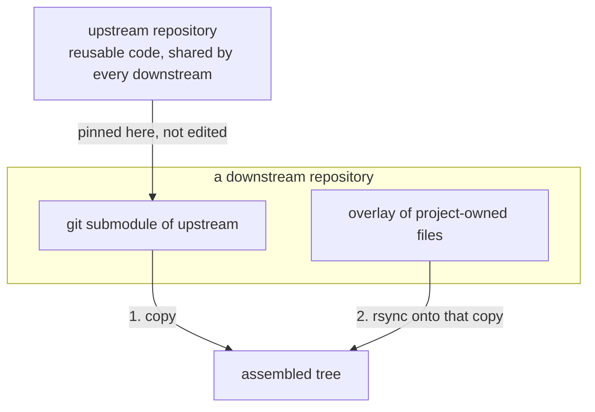
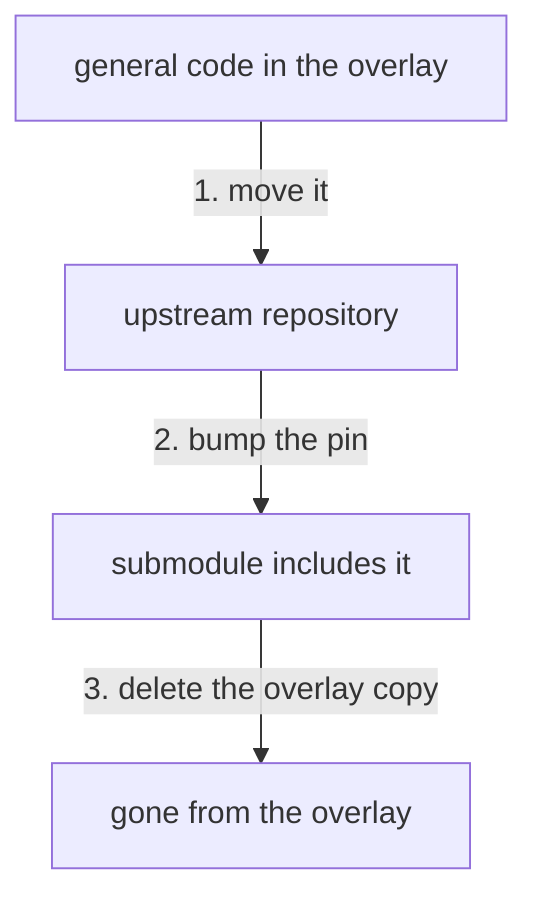
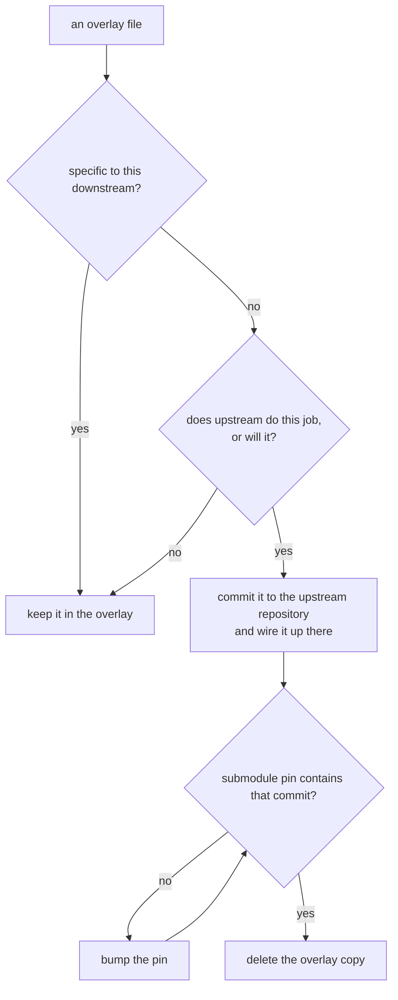

# /distill

## Why to distill?

The basic setup is that you have a core code base (the "upstream" repository) with background intellectual property, re-usable functionality, or common code. Then, you want to use it and customize it for various specific projects (the "downstream" repositories), perhaps with their own proprietary intellectual property and code.

One setup may entail the upstream repository being a git sub-module of the downstream repository, and a script which copies the upstream and then modifies specific files (e.g. with `rsync`) so that the re-usable pieces of the upstream code are not affected, but downstream can make modifications.

This could look something like this:

To _distill_ is to clearly and cleanly separate which code belongs upstream versus downstream, and to move common functionality and code (which is not specific to a downstream project but more general intellectual property) into the upstream repository, where upstream itself runs it.

## How to distill?

### General Instructions

Look for generic functionality in downstream repositories, and wonder if any could be re-usable which belongs in upstream. Often, legal requirements may need any project-specific functionality to be delivered in the downstream repository, so you must consider carefully if something is intellectual property for a downstream user and cannot legally be distilled upstream. However, there is often more that can be distilled upstream than you think. There are general functionalities and utilities and common code patterns which are not downstream-specific but falsely live in downstream.

This requires reviewing downstream code (perhaps from multiple repositories) and comparing it to upstream code, and seeing where that distillation boundary should really lie. Survey and triage before deciding, as below. Judge each file by what it does, not where it lives: generic mechanism (logging, timing, retries, cancellation) often sits inside a folder named for a downstream feature.

In addition, look for opportunities to refactor downstream code bases so that it's easier to distill. For instance, by collecting common function parameters into a configuration object that is passed around, this may unlock new distillation opportunities even if the original code itself was difficult to distill.

When code moves upstream, rename branded identifiers to generic ones, and turn branded values into parameters the downstream supplies. Persisted values (database names, stored strings) keep their spelling.

### Catch Up First

Start by bumping the submodule pin to the newest upstream. The overlay is often the stale side, still carrying an old copy of a file upstream has since improved. Delete those copies, keeping only any real downstream change.

### Survey, Triage, Then Act

Do not act on the first candidate you find. It is the one closest to hand, not the most valuable, and every way of looking at the code shows candidates the others miss.

1. **Keep a backlog.** Candidates persist across rounds in one place both repositories' maintainers can see. A round adds to it; a candidate leaves only when it is done or ruled out with a written reason, never because a later survey forgot it.
2. **Start from demand.** What upstream must do next, and what hurts at every pin bump: files that change together in both repositories, shadows that conflict at each adoption. These candidates arrive with a caller.
3. **Survey through many lenses, and invent new ones each round.** Each lens yields candidates, not changes. Some lenses:
   - behaviour: grep for what any copy must touch (heartbeat threads, caches, retries, storage calls, status updates), and group by what the code does, never by name or folder;
   - shadows ranked by diff size, and stale copies upstream has since improved;
   - modules, layers, frontend against backend;
   - types and function signatures that describe the same record or job;
   - one unit spread across packages, and other anti-patterns;
   - upstream code with no caller of its own.

   A lens fitted to this pair of repositories beats a stock one.
4. **Record each candidate** in one line: the unit in a sentence, where it lives in each repository, its upstream caller, and the overlay lines it would remove.
5. **Aggregate.** Merge duplicates, and group candidates that are one unit in several places. A unit that several lenses found is a stronger candidate, and one move may settle the whole group.
6. **Triage each group in writing**: value, risk (behaviour, schema, auth, boot), ownership, and order. Mechanical deletions, such as an overlay copy identical to upstream or differing only in comments, skip triage and go straight through.
7. **Decide** the moves with the best value for their risk, in dependency order, and note why each other candidate waits.
8. **Re-check at the current tip, then act**, one reviewable change per decision. Other people push while you survey.

Why: surveying is cheap and moving code is not. A move upstream changes a contract every downstream inherits, and a wrong one costs a second move to undo. Starting from demand gives each move a caller; many lenses find what any single lens misses; the backlog stops each round from rediscovering the last; and the written triage lets someone else check the decision.

### Wire It Up

Distilled code must be used by upstream itself, not just moved there. Either replace upstream's own copy of the same logic with it, or mount it in upstream's runtime. Before deciding upstream has no use for it, look for upstream code doing the same job another way, such as parsing a stream where the downstream uses middleware; replacing that is the use. Leave it downstream only when nothing upstream does that job. A feature behind a flag that is off by default is not used.

### Seams

When an overlay file is mostly generic with a small downstream-specific part, move the generic part upstream with a seam: a registration hook or injected callback that upstream calls, with a neutral default. The downstream registers its part, and the overlay shrinks to that registration. Upstream never imports downstream code.

### Submodule Pins

General code that is sitting in the overlay moves upstream. Delete the overlay copy only after the submodule pin includes it, so the build copy still supplies it and the overlay rsync no longer replaces it.

Run that path only for general intellectual property, and only in that order. Project-specific code never enters it. Do not delete the overlay copy while the pin check is still no.

Merge upstream work with merge commits rather than squashes, so the pinned commit stays reachable upstream.

### Shattering

Sometimes if there is a really long upstream file, and the downstream overlay only modifies a very small part of that file, instead of needing to overwrite the entire file downstream, it could be distilled by shattering that file into multiple smaller files first. Then, let's say you take a thousand line file and shatter it into ten different files, each a hundred lines, nine of those do not need to be overlaid at all, and only the one small file which needs the change had to be overlaid from upstream. This allows more re-usable code upstream.

### Verify

A round is done when upstream's tests pass, the assembled tree passes the downstream's checks, every moved piece has an upstream caller, and the overlay is smaller.
